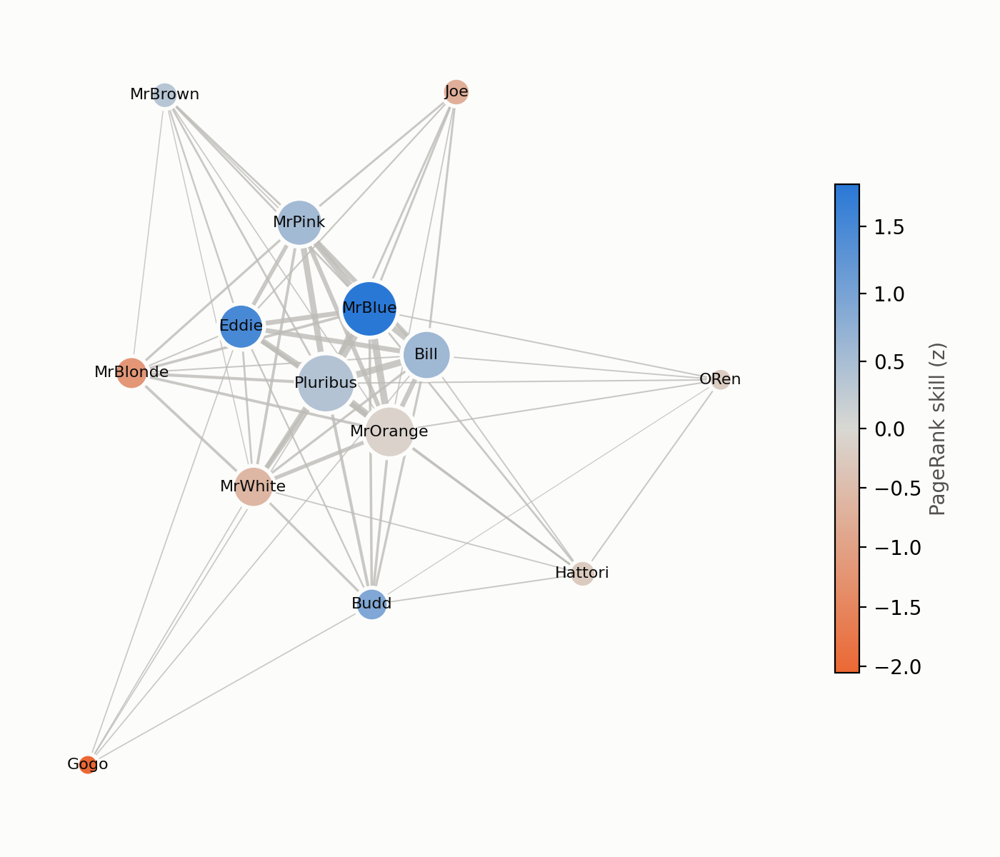
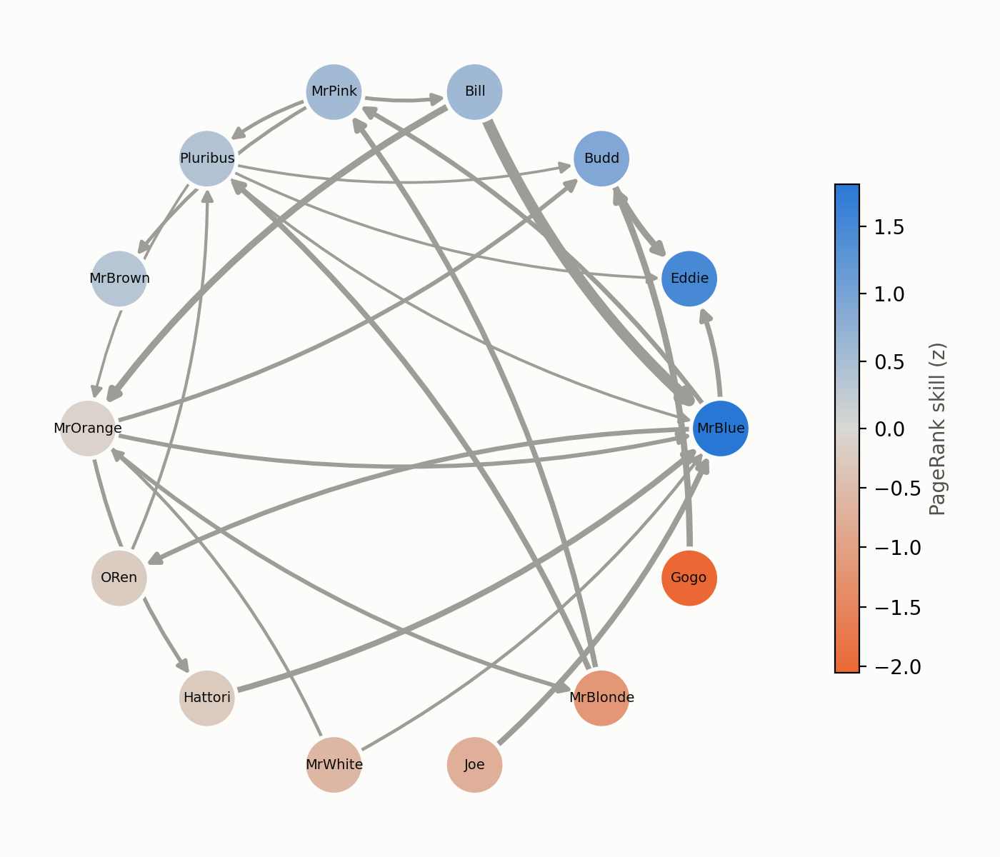
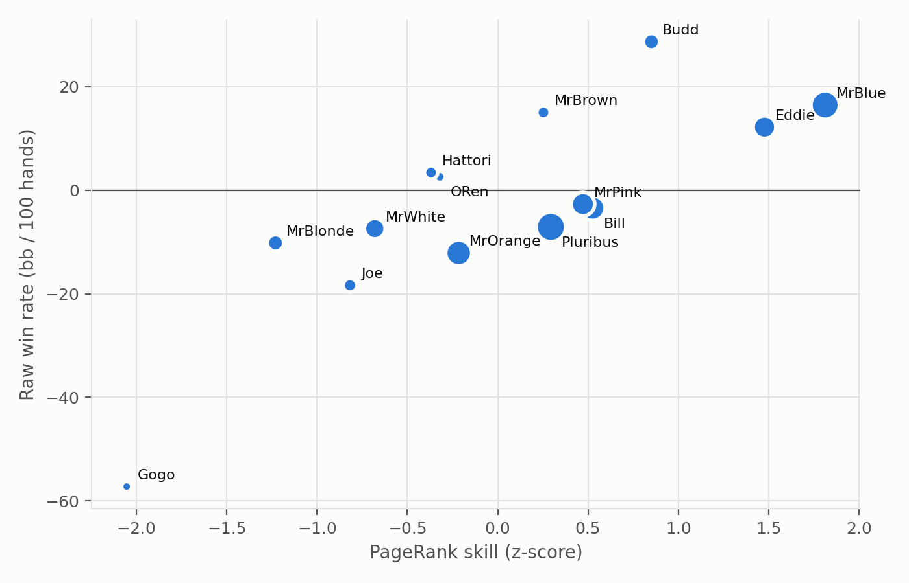
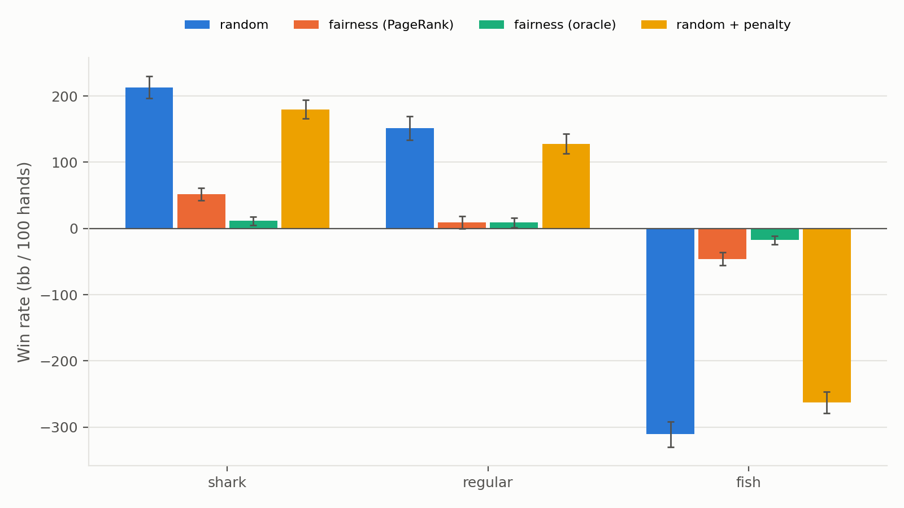
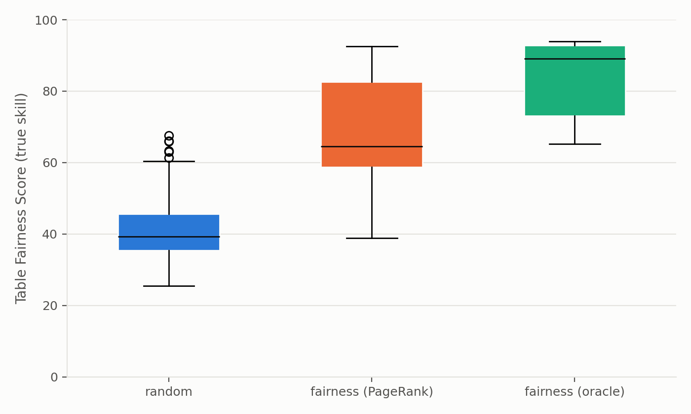
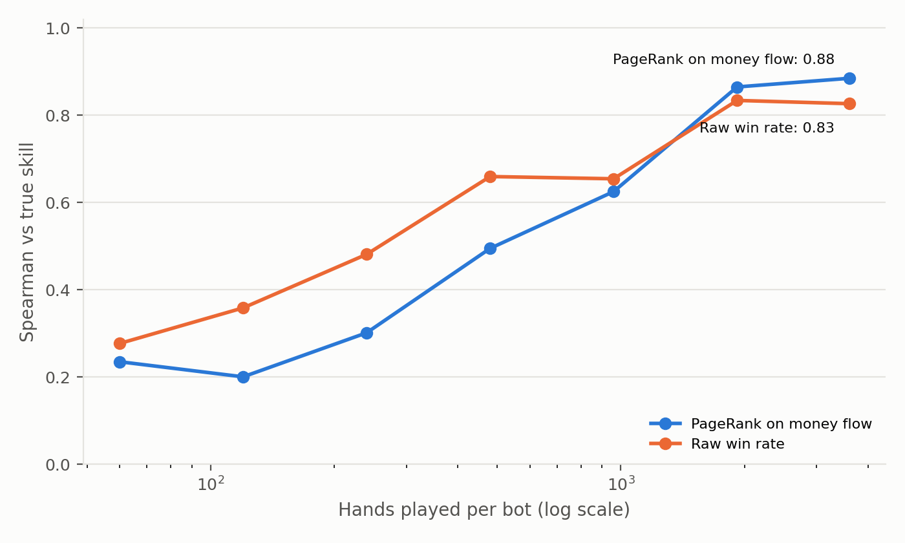

# Fair Poker Tables: Project Guide

Last updated 2026-11-23. Charts are in [docs/figures/](figures/).

## Start here

Seating players by Fairness Score cut weak players' losses by **85%** in our bot test (−311 → −46 big blinds per 100 hands), using only ratings learned from play history. Everything below explains where each number comes from, where each file lives, and what is left for the group to fill in.

- **Slides:** [How Do I Get Rinsed Less? deck](https://claude.ai/artifact/4zrCotk3ZxEhYt8GzeMJb9) (16 slides, speaker notes on every slide)
- **Code:** this repo, branch `feature/fair-table-analysis` until it is merged into `main`
- **Other docs:** [README](../README.md), [methodology](methodology.md), [results](results.md)

**The project in four lines:**

1. **Analysis:** build two graphs from 10,000 real hands (who shared a table, who lost money to whom) and rate players with PageRank.
2. **Evaluation of the problem:** raw win rate over a few thousand hands is almost pure luck; PageRank ratings are much more stable.
3. **Solution:** a Fairness Score per table (100 = evenly matched), used to seat players or to penalize unfair tables.
4. **Demo:** 36 bots of known skill play real hold'em under random vs fairness-based seating.

**What the group needs to do:**

- [ ] Put team names and the presentation date on slide 1 (replace the bracketed placeholders)
- [ ] Read the speaker notes and decide who presents which section (Slide map below)
- [ ] Review and merge the pull request into main
- [ ] Check the course label on slide 1 ("427 Group Project · Network Analysis")
- [ ] Rehearse answers to the questions in Limits and likely questions

## Where things are

All code lives under `src/fairpoker/`, one folder per job; every setting lives in `config/default.toml`. Generated results go to `var/`, which is not in git: run `python main.py all` to rebuild it. Copies of the charts are kept in `docs/figures/`.

| Path | What it does |
| --- | --- |
| `main.py` | Command-line entry point: `analyze`, `simulate` or `all` |
| `config/default.toml` | Every tunable value: paths, PageRank damping, fairness scale, bot traits, population, session counts, seed |
| `poker-hand-histories.zip` | The PHH dataset, read straight from the zip (no unzipping) |
| `src/fairpoker/config.py` | Loads and checks the config; the one place that creates output folders |
| `src/fairpoker/hands/` | `HandRecord` (players + net result per hand) and the pokerkit loader for `.phh` files |
| `src/fairpoker/network/graphs.py` | Builds the co-play graph and the money-flow graph |
| `src/fairpoker/network/ratings.py` | PageRank skill score (with retention loops), win rates, centrality |
| `src/fairpoker/network/tiers.py` | k-means skill tiers (shark / regular / fish) and Louvain player pools |
| `src/fairpoker/fairness/score.py` | The Fairness Score formula |
| `src/fairpoker/fairness/seating.py` | Seating policies: random, and sorted by skill |
| `src/fairpoker/fairness/penalty.py` | Unfair-table penalty: winners give part of their profit back to losers |
| `src/fairpoker/simulation/cards.py` | Fast hand evaluator (checked against pokerkit) |
| `src/fairpoker/simulation/equity.py` | Win-chance estimates for bots (preflop table cached in `var/cache`) |
| `src/fairpoker/simulation/bots.py` | Bots whose play quality is one skill number from 0 to 1 |
| `src/fairpoker/simulation/engine.py` | 6-max no-limit hold'em engine: blinds, 4 betting rounds, side pots, showdown |
| `src/fairpoker/simulation/sessions.py` | Builds the bot population and plays one table session |
| `src/fairpoker/pipelines/dataset_analysis.py` | Real-data workflow: graphs, ratings, tiers, pools, table fairness, reliability checks |
| `src/fairpoker/pipelines/seating_experiment.py` | Bot experiment: history phase, ratings, then each seating policy |
| `src/fairpoker/reporting/` | Writes the CSV / JSON reports and draws the PNG charts |
| `tests/unit/` | 12 tests: evaluator vs pokerkit, chip conservation, graphs, fairness, seating, tiers |
| `docs/methodology.md`, `docs/results.md` | Written explanation of the method and every result |
| `docs/project-guide.md` | This guide |
| `docs/figures/` | Copies of the 6 slide charts, so they show on GitHub |
| `var/reports/` (generated) | `dataset_players.csv`, `dataset_sessions.csv`, `dataset_summary.json`, `experiment_*.csv`, `experiment_summary.json` |
| `var/figures/` (generated) | The 6 PNG charts, rebuilt on every run |

## Slide map

The deck has 16 slides in 5 sections; only slide 1 has placeholders, and every number traces to a file in `var/reports/`. Each slide has speaker notes (open the notes panel in the deck).

| # | Slide | Shows | Numbers come from | To fill in |
| --- | --- | --- | --- | --- |
| 1 | Cover | Title, subtitle | — | Team names, date, course label |
| 2 | The problem | 3 reasons players get rinsed | — | — |
| 3 | Our answer | One-line solution | — | — |
| 4 | Approach | 5 pipeline steps | — | — |
| 5 | Data | 10,000 hands, 14 players, 92 sessions, 65 of 91 pairs | `dataset_summary.json` | — |
| 6 | Two graphs | Co-play and money-flow charts | `dataset_coplay_network.png`, `dataset_money_flow.png` | — |
| 7 | PageRank vs win rate | Scatter; 0.34 vs 0.02 stability; Pluribus | `dataset_players.csv`, `dataset_summary.json` | — |
| 8 | Tiers and pools | Shark / regular / fish lists, Louvain pools, Gogo exposure | `dataset_players.csv`, `dataset_summary.json` | — |
| 9 | Fairness Score | Formula; 100, ≈37, 32–54 | `dataset_sessions.csv` | — |
| 10 | Game theory | Who wants what; two levers | — | — |
| 11 | Evaluation setup | Bot traits, 4-step protocol | `config/default.toml` | — |
| 12 | Result: 85% | Headline number | `experiment_summary.json` | — |
| 13 | Win rate by tier | Grouped bar chart + 3 callouts | `experiment_tier_results.csv` | — |
| 14 | Tables and ratings | Fairness box plot + accuracy curve | `experiment_tables.csv`, `experiment_rating_accuracy.csv` | — |
| 15 | Limits and next steps | 4 limits, 4 next steps | `dataset_summary.json` (p = 0.42) | Add your own next steps if you like |
| 16 | Takeaway | Three-step recipe, repo link | — | — |

**Suggested split for 4 presenters:** problem and approach (slides 1–4), real-data analysis (5–8), solution and game theory (9–10), evaluation and wrap-up (11–16).

## Analysis: real Pluribus data

On 10,000 real hands, PageRank ratings were far more stable than raw win rate (0.34 vs 0.02), but the dataset is too small to prove that seating helps. It holds 14 players across 92 sessions, and Pluribus plays every hand. Only 65 of the 91 possible player pairs ever shared a table.





**Player ratings** (sorted by PageRank skill; skill is a z-score, so 0 = average):

| Player | Hands | Raw win rate (bb/100) | PageRank skill (z) | Tier | Opponents faced | Pool |
| --- | --- | --- | --- | --- | --- | --- |
| MrBlue | 9,121 | +16.5 | +1.81 | shark | 12 | Core |
| Eddie | 5,510 | +12.2 | +1.48 | shark | 11 | Core |
| Budd | 2,509 | +28.7 | +0.85 | shark | 9 | Group A |
| Bill | 6,713 | −3.4 | +0.53 | regular | 13 | Core |
| MrPink | 6,055 | −2.7 | +0.47 | regular | 9 | Core |
| Pluribus | 10,000 | −7.1 | +0.29 | regular | 13 | Core |
| MrBrown | 1,378 | +15.0 | +0.25 | regular | 8 | Core |
| MrOrange | 7,512 | −12.1 | −0.22 | regular | 12 | Core |
| ORen | 771 | +2.6 | −0.32 | regular | 6 | Group A |
| Hattori | 1,365 | +3.4 | −0.37 | regular | 7 | Group A |
| MrWhite | 4,483 | −7.4 | −0.68 | fish | 11 | Group B |
| Joe | 1,535 | −18.4 | −0.82 | fish | 6 | Core |
| MrBlonde | 2,560 | −10.2 | −1.23 | fish | 8 | Group B |
| Gogo | 488 | −57.2 | −2.05 | fish | 5 | Group A |



**What the analysis shows:**

- **Win rate is mostly luck at this sample size.** We rated players on odd-numbered sessions and on even-numbered sessions separately. The two win-rate rankings agree at Spearman 0.02 (essentially random); the two PageRank rankings agree at 0.34.
- **PageRank credits who you beat.** Pluribus finished at −7.1 bb/100, below 8 of the 13 humans, yet PageRank rates it above average because it won money from strong players. The original study used variance reduction and found Pluribus beat the pros.
- **Centrality tells you how far to trust a rating.** Gogo's −57 bb/100 comes from only 488 hands against 5 opponents, so that rating is the least reliable. Bill and Pluribus faced all 13 others.
- **Pools (Louvain on the co-play graph):** a core of 8 around Pluribus, Group A = {Budd, Gogo, Hattori, ORen}, Group B = {MrBlonde, MrWhite}. These are the players who mostly sat together.
- **Table fairness on real tables ranges from 31.7 to 54.4** (mean 43.7). The least fair lineup was Bill, Budd, Eddie, Gogo, MrWhite, Pluribus; the fairest was Bill, Eddie, MrBlue, MrBrown, MrPink, Pluribus.
- **Held-out test, no detectable link:** we rated players without each session, scored that session's table, and checked whether lower fairness predicted a bigger loss for its weakest player. Spearman −0.08, p = 0.42. With Pluribus at every table and about 109 hands per session, the data cannot answer this; the bot experiment does.

Source files: `var/reports/dataset_players.csv`, `dataset_sessions.csv`, `dataset_summary.json`.

## Results: bot seating experiment

Seating by Fairness Score cut the weakest bots' losses by 85%, from −311 to −46 bb/100, without ever seeing true skill. Seating by true skill (the oracle) reaches 94%; the penalty alone only 16%.



| Policy | Sharks (bb/100) | Regulars (bb/100) | Fish (bb/100) | Fish loss cut |
| --- | --- | --- | --- | --- |
| Random seating | +213 ± 17 | +151 ± 18 | −311 ± 19 | — |
| **Fairness seating (PageRank)** | +52 ± 9 | +9 ± 10 | **−46 ± 10** | **85%** |
| Fairness seating (oracle) | +12 ± 6 | +9 ± 7 | −18 ± 7 | 94% |
| Random + unfair-table penalty | +180 ± 14 | +128 ± 15 | −262 ± 16 | 16% |

± is one standard error across sessions; 14,400 hands per policy.

- **Seating does almost all the work:** PageRank seating gets 90% of the way from random seating to the perfect-knowledge oracle.
- **Sharks pay for it:** their edge falls from +213 to +52 bb/100, and regulars drop from +151 to about break-even. That is the site's trade-off.
- **The penalty barely helps fish:** a 25% levy on unfair tables returns too little of each pot.
- **Tables get fairer:** mean true Fairness Score is 41 under random seating, 68 under PageRank seating and 84 under the oracle. The site believes its tables score 81, so some players are mis-rated.





Below about 1,000 hands per bot, raw win rate ranks bots better; after that, PageRank leads (0.88 vs 0.83 at 3,600 hands). Source files: `var/reports/experiment_summary.json`, `experiment_tier_results.csv`, `experiment_tables.csv`, `experiment_rating_accuracy.csv`.

## Method details and design decisions

The method is: two graphs, PageRank with one fix, a spread-based Fairness Score, and bots whose skill changes only how well they play. Full write-up: [methodology.md](methodology.md).

**Two graphs.**

- **Co-play:** undirected, players are nodes, edge weight = hands two players shared. Gives centrality (opponents faced) and Louvain pools.
- **Money flow:** directed loser → winner. In each hand, each loser's chips are split between that hand's winners by their share of the winnings; flows between a pair are then netted, so at most one edge joins two players.

**Skill = PageRank on money flow.** Money flows toward skill, so rank collects where money goes, and beating a strong player counts more than beating a weak one. The skill score is the z-scored log of PageRank (damping 0.85).

**The retention-loop fix.** Plain PageRank makes a node pass on all of its rank through its out-edges, however small its losses are. So each player also gets a self-loop worth what they won; now rank leaks only in proportion to losses / (losses + wins). Tested on bots with known skill (Spearman with true skill):

| Hands per bot | Plain PageRank | With retention loops | Raw win rate |
| --- | --- | --- | --- |
| 480 | −0.06 | 0.49 | 0.66 |
| 960 | 0.32 | 0.63 | 0.65 |
| 1,920 | 0.65 | 0.80 | 0.77 |

**Tiers.** 1-D k-means with k = 3 on the skill score: top cluster = shark, bottom = fish, middle = regular.

**Fairness Score.** σ = standard deviation of the seated players' skill scores; scale = 1.0 in config.

```
Fairness = 100 × exp(−σ / scale)
```

A player's expected loss grows with how far they sit below the table's average skill, and summed over the table those gaps are the spread. 100 = equal skill; about 37 = as spread out as the whole pool.

**Two levers.**

- **Seat by score:** sort players by estimated skill and fill tables in order. For equal-size tables this gives the lowest total skill variance inside tables.
- **Penalty:** on each hand, winners give back 25% × (1 − Fairness/100) of their profit, split among that hand's losers. Chips are conserved; a perfectly fair table pays nothing.

**Bots.** One skill number s from 0 to 1 sets four traits; skill never decides who wins.

| Trait | Low skill | High skill |
| --- | --- | --- |
| Equity noise | Misjudges hand strength | Judges it accurately |
| Looseness | Calls with worse odds than the pot gives | Respects pot odds |
| Hand reading | Ignores bet size | Folds marginal hands to big bets |
| Aggression | Passive, rarely raises | Raises strong hands, bluffs a little |

**Engine.** Our own 6-max no-limit hold'em engine (blinds 50/100, 100 big blinds at the start of each hand, like the Pluribus data). Its hand evaluator matches pokerkit on 3,000 random showdowns and runs about 35× faster, which the bots' win-chance sampling needs.

**Experiment protocol.**

1. Population: 36 bots = 9 sharks (s 0.85–1.0), 14 regulars (0.45–0.65), 13 fish (0–0.2).
2. History: 20 sessions × 60 hands, random seating, 7,200 hands. Nobody knows anyone's skill.
3. Rating: PageRank on that history.
4. Evaluation: 40 more sessions per policy (14,400 hands each), ratings refreshed after every session.
5. Same deck seed for table t of session k under every policy, so policies differ by seating, not card luck.
6. Seed 427: the run is deterministic and reproduces exactly.

## Limits and likely questions

The biggest limit is that the seating result comes from bots, not real players: the real dataset is too small to test it. Short answers for the questions an audience is most likely to ask:

| Likely question | Short answer |
| --- | --- |
| Why use bots instead of real data for the main result? | The real data has 14 players and Pluribus at every table, so fairness only varies from 32 to 54. Bots give 36 players with known skill, so we can check against the truth. |
| Aren't the bot losses unrealistic (−311 bb/100)? | Yes, the skill gaps are exaggerated on purpose so the signal is clear. Real weak players lose closer to 10–100 bb/100. The comparison between policies is the point, not the absolute size. |
| Doesn't the bot design decide the result? | Skill never picks who wins a hand. It only changes how well a bot judges hands, respects pot odds and sizes bets; the edge comes from playing real hands. |
| Why PageRank and not just win rate? | On real data PageRank is far more stable (0.34 vs 0.02). On bots it beats win rate once players have about 1,000+ hands (0.88 vs 0.83 at 3,600). |
| When is PageRank worse? | With few hands: below about 1,000 hands per player, raw win rate ranks bots better. A site would blend them or require a minimum number of hands. |
| Why did the real held-out test find nothing? | p = 0.42: about 109 hands per session is mostly luck, and fairness barely varies because Pluribus is always seated. It is a data-size limit, not evidence against the method. |
| Why is the penalty so weak? | At a 25% rate it returns only a slice of each pot (16% less fish loss). It works better as a deterrent against picking fish tables than as protection. |
| Won't sharks just leave? | Their edge drops from +213 to +52 bb/100. That is the site's trade-off: less shark profit now, more recreational players who stay. We did not model churn. |
| Is the engine real poker? | Real 6-max no-limit hold'em with side pots, with one simplification: every raise reopens betting, even a short all-in. |
| Are ratings accurate under fairness seating? | Partly: the site thinks its tables score 81 on average, but true fairness is 68. Some mis-rated players land at the wrong table. |

## How to rerun everything

One command rebuilds every number and chart in about 2 minutes (Python 3.11+). From the repo folder:

1. `git checkout feature/fair-table-analysis` (or `main` once merged)
2. `pip install -e ".[dev]"`
3. `python main.py all` (or `analyze` for real data only, about 10 s; `simulate` for bots only, about 75 s)
4. `python -m pytest` to run the 12 tests

Results land in `var/reports/` (CSV and JSON) and `var/figures/` (the slide charts). The first simulate run also builds a preflop table in `var/cache/` (about 10 s, then cached). If you rerun and want the charts in `docs/figures/` to match, copy them over from `var/figures/`.

**Settings worth changing** (all in `config/default.toml`):

| Setting | Section | Default | Effect |
| --- | --- | --- | --- |
| `player_count` | `[population]` | 36 | Bots in the pool (multiple of 6) |
| `tiers` | `[population]` | 25% / 40% / 35% | Share and skill range of sharks, regulars, fish |
| `history_sessions` | `[experiment]` | 20 | Random sessions before the site rates anyone |
| `evaluation_sessions` | `[experiment]` | 40 | Sessions per seating policy |
| `seed` | `[experiment]` | 427 | Change it to check the result holds on other runs |
| `workers` | `[experiment]` | 12 | Parallel processes; lower it on a weaker laptop |
| `penalty_rate` | `[fairness]` | 0.25 | Strength of the unfair-table penalty |
| `skill_std_scale` | `[fairness]` | 1.0 | How fast the Fairness Score falls as skill spreads |
| `equity_noise_max`, `call_looseness_max` | `[bots]` | 0.22 | How badly low-skill bots play; lower = more realistic losses |

If you change a setting, the numbers in the slides and in this guide will no longer match: rerun, then update slides 5, 7–9 and 12–14 from the new `var/reports/` files.
